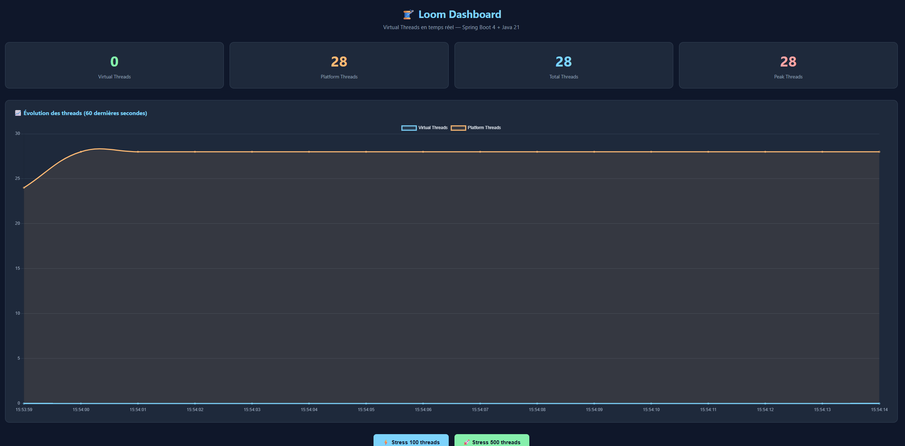
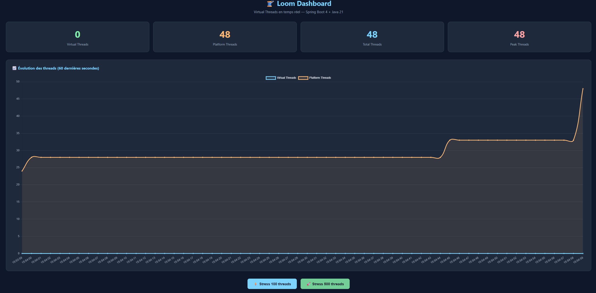
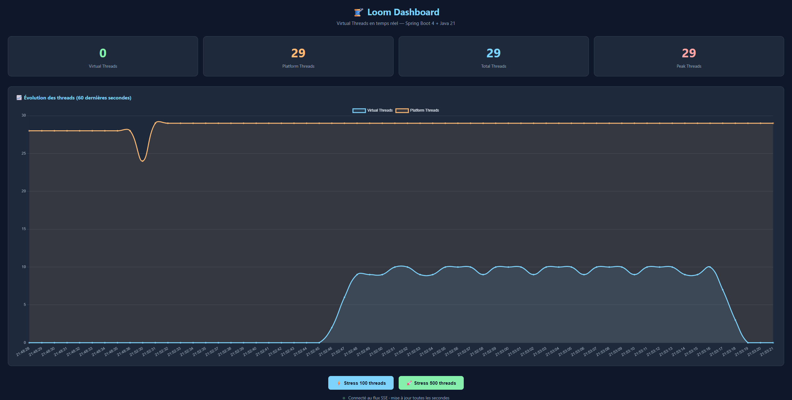
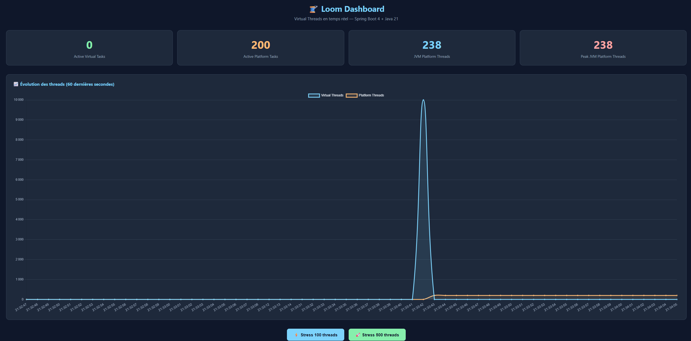
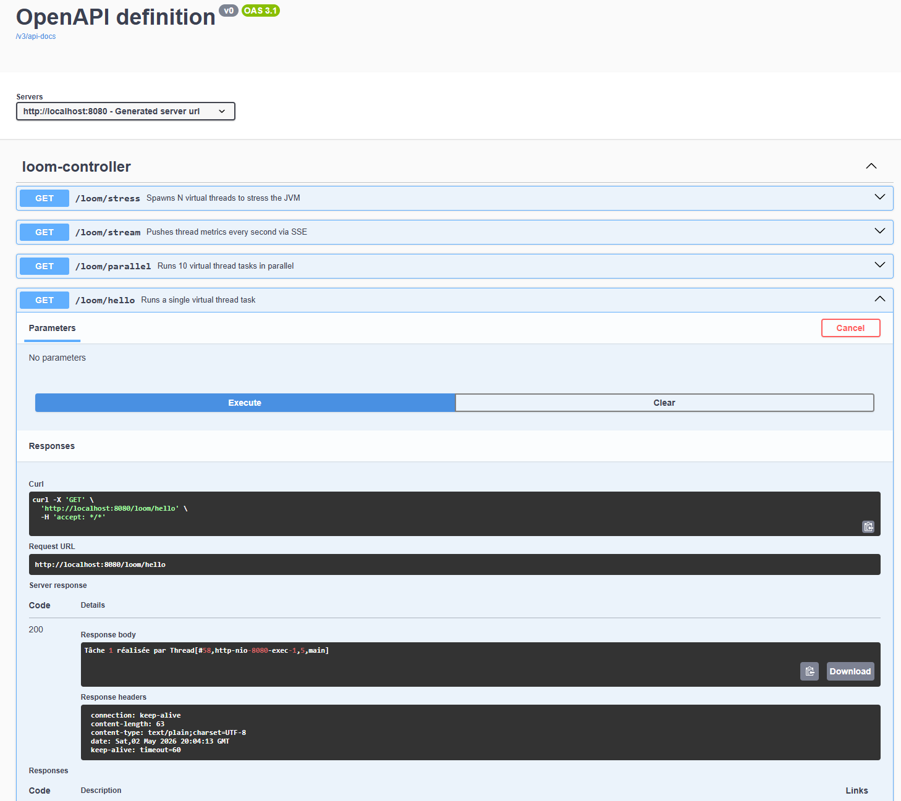
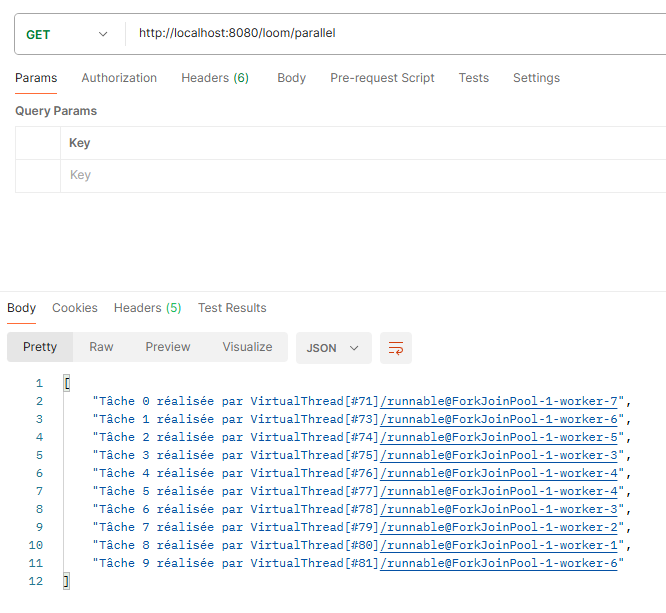

# loom-spring-playground
Exploring Java virtual threads with Spring Boot and Project Loom.

## Tech Stack

| Technology        | Version             |
|-------------------|---------------------|
| Java              | 27                  |
| Maven             | 3.9.14              |
| Spring Boot       | 4.1.2               |
| Project Loom      | Built-in (Java 27+) |
| springdoc-openapi | 3.0.3               |
| Chart.js          | Latest              |

## Metrics

Create a dashboard.html file in src/main/resources/static/, or use the one already provided in the repository.  
Run the Spring Boot application.  
Then open http://localhost:8080/dashboard.html in your browser.  

The dashboard displays the following metrics in real time :
- Virtual Threads : Lightweight threads managed by the JVM, the core of Project Loom ;
- Platform Threads : Traditional OS-level threads, heavy and limited in number ;
- Total Threads : Sum of virtual and platform threads currently running ;
- Peak Threads : Maximum number of threads reached since the application started.

### Dashboard example without stress


### Dashboard example with stress


### Optional

You can tweak the following values in application.properties:
- **loom.thread.create.tempo**: delay (in ms) between each thread creation ;
- **loom.thread.life.tempo**: delay (in ms) for how long each thread stays alive ;



## Benchmark

You can run a benchmark comparing virtual threads against platform threads.  
Here with 10,000 blocking tasks for each type.

With virtual threads, almost all tasks can be started at once. In the dashboard,
`activeVirtualTasks` can briefly peak near 10,000, then quickly drop when the
simulated blocking work finishes.

With platform threads, the benchmark uses a fixed thread pool of 200 threads.
Only 200 tasks can run at the same time, while the remaining tasks wait in the
executor queue. The workload therefore lasts longer and `activePlatformTasks`
stays around 200 until all queued tasks are processed.
To match the same level of concurrency with platform threads, the JVM would need
to create thousands of native OS threads, which is much more expensive and may
hit system limits.
On a typical modern developer machine with 16-32 GB of RAM and 8-24 logical
processors, creating more than a few hundred platform threads in parallel is
usually not recommended for regular application workloads.

This benchmark shows that virtual threads are especially useful for highly
concurrent blocking workloads, such as database calls, HTTP calls, file I/O, or
any operation where threads spend most of their time waiting. It does not mean
that virtual threads make CPU-bound work faster.



## Pinning

With `synchronized`, the carrier thread can be pinned while the virtual thread
is sleeping inside the monitor:
```json
{"strategy":"synchronized","taskCount":100,"timeMs":824}
```

With `ReentrantLock`, the JVM can unmount the virtual thread while it is waiting:
```json
{"strategy":"ReentrantLock","taskCount":100,"timeMs":117}
```

> 💡 `synchronized` pins the carrier thread during I/O, blocking all other virtual threads.  
> Use `ReentrantLock` instead to let the JVM freely schedule virtual threads.

## Endpoints

### Definition

| Method | Endpoint                  | Description                                                |
|--------|---------------------------|------------------------------------------------------------|
| GET    | `/loom/hello`             | Runs a single virtual thread task                          |
| GET    | `/loom/info`              | Returns runtime information about the playground           |
| GET    | `/loom/parallel?count=10` | Runs N virtual thread tasks in parallel                    |
| GET    | `/loom/stream`            | Pushes thread metrics every second via SSE                 |
| GET    | `/loom/stress?count=100`  | Spawns N virtual threads to stress the JVM                 |
| GET    | `/loom/benchmark`         | Runs a benchmark: virtual threads vs platform threads      |
| GET    | `/loom/pinning/good`      | Demonstrates pinning avoidance using ReentrantLock         |
| GET    | `/loom/pinning/bad`       | Demonstrates carrier thread pinning caused by synchronized |

### Actuator

Spring Boot Actuator is available once the application is running:
- http://localhost:8080/actuator/health
- http://localhost:8080/actuator/info

### Swagger

Swagger UI is available at http://localhost:8080/swagger-ui.html once the application is running.  



### Postman example

